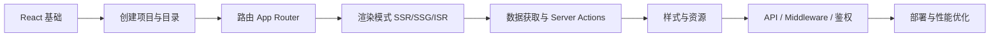

# Next.js 知识体系与学习路线

本篇目标：为初学者梳理 **Next.js 是什么、先学什么、核心原理是什么**，并通过 **常见问题与解答** 快速建立完整知识地图。建议前置：熟悉 **HTML/CSS、JavaScript（ES6+）、React 基础（组件、Hooks、JSX）**。

---

## 学习路线总览（建议 4～6 周）



| 阶段 | 主题 | 掌握标准 |
| --- | --- | --- |
| **第 1 周** | 环境、目录、`page`/`layout` | 能新建项目并做多页面导航 |
| **第 2 周** | 服务端/客户端组件、数据获取 | 能解释 RSC 边界，会用 `fetch` 在服务端取数 |
| **第 3 周** | 动态路由、Loading/Error、Metadata | 能写 `[id]` 详情页与 SEO 基础配置 |
| **第 4 周** | Route Handlers、Middleware、缓存 | 能写简单 BFF 与登录拦截 |
| **第 5～6 周** | 部署、性能、进阶（Partial Prerender 等） | 能上线 Vercel/Node，会用 Lighthouse 找瓶颈 |

---

## 一、Next.js 是什么？解决什么问题？

&emsp;&emsp;**Next.js** 是基于 **React** 的全栈 Web 框架，由 Vercel 维护。它在 React 之上提供：**基于文件系统的路由**、**多种渲染策略（SSR/SSG/ISR/CSR）**、**服务端与边缘运行时**、**内置优化（图片、字体、代码分割）** 等，让你用一套代码同时做好 **SEO、首屏性能、API 与前端界面**。

&emsp;&emsp;**典型使用场景：**

- 营销站、文档站（需要 SEO + 静态或 ISR）
- 仪表盘、SaaS（需要鉴权、服务端取数、部分 CSR 交互）
- 电商、内容平台（动态路由 + 缓存策略）

&emsp;&emsp;**与「纯 React（如 Vite + React Router）」对比：**

| 维度 | 纯 React SPA | Next.js |
| --- | --- | --- |
| 首屏 HTML | 多为空壳 + JS 注水 | 可直接输出完整 HTML（SSR/SSG） |
| SEO | 需额外 SSR 方案 | 内置 Metadata、服务端渲染 |
| 路由 | 需自行配置 | `app/` 或 `pages/` 文件即路由 |
| 后端能力 | 需单独起 Node 服务 | Route Handlers / Server Actions |
| 部署 | 静态托管即可 | 静态、Node、Serverless、Edge 均可 |

---

## 二、核心知识模块

### 1、两大路由体系（优先学 App Router）

&emsp;&emsp;**App Router（推荐，Next.js 13+，当前默认）**

- 目录：`app/`
- 特殊文件：`page.tsx`（页面）、`layout.tsx`（布局）、`loading.tsx`、`error.tsx`、`not-found.tsx`、`route.ts`（API）
- 默认使用 **React Server Components（RSC）**

&emsp;&emsp;**Pages Router（旧项目常见）**

- 目录：`pages/`
- `pages/index.js` → `/`，`pages/blog/[id].js` → 动态路由
- 数据获取：`getServerSideProps`、`getStaticProps`、`getStaticPaths`

&emsp;&emsp;**初学者建议：** 新项目只学 **App Router**；维护老项目时再补 Pages Router。

---

### 2、渲染模式（核心原理）

&emsp;&emsp;Next.js 的核心价值在于 **按路由选择「何时、在哪生成 HTML」**。

| 模式 | 英文 | 何时生成 HTML | 典型场景 |
| --- | --- | --- | --- |
| **静态生成** | SSG | 构建时 | 博客、文档 |
| **服务端渲染** | SSR | 每次请求（服务器） | 个性化、实时数据 |
| **增量静态再生** | ISR | 构建 + 定时/按需重建 | 大列表、CMS 内容 |
| **客户端渲染** | CSR | 浏览器 | 强交互区域（配合 RSC） |

&emsp;&emsp;**App Router 中的对应关系（简化）：**

- 默认 Server Component → 在 **服务端** 渲染为 HTML 流式输出
- `fetch(url, { cache: 'force-cache' })` 或未指定 → 类似静态/缓存行为
- `fetch(url, { cache: 'no-store' })` → 动态 SSR
- `export const revalidate = 60` → ISR（秒）
- `'use client'` 组件 → 浏览器 hydration，负责交互

```tsx
// app/posts/page.tsx — 动态 SSR 示例
export const dynamic = 'force-dynamic' // 或 fetch(..., { cache: 'no-store' })

export default async function PostsPage() {
  const res = await fetch('https://api.example.com/posts', { cache: 'no-store' })
  const posts = await res.json()
  return (
    <ul>
      {posts.map((p: { id: string; title: string }) => (
        <li key={p.id}>{p.title}</li>
      ))}
    </ul>
  )
}
```

---

### 3、React Server Components（RSC）与客户端组件

&emsp;&emsp;**Server Component（默认）**

- 在服务端运行，**不会**把组件 JS 发到浏览器（减小 bundle）
- 可直接 `async/await` 读数据库、读文件、调内部 API
- **不能** 使用 `useState`、`useEffect`、浏览器 API、事件处理器

&emsp;&emsp;**Client Component（文件顶行 `'use client'`）**

- 需要交互、Hooks、第三方仅客户端库时使用
- 作为 Server Component 的 **子树** 被引用（注意：不能反过来在 Client 里 import Server 组件再嵌套违规用法）

```tsx
// app/components/Counter.tsx
'use client'

import { useState } from 'react'

export function Counter() {
  const [n, setN] = useState(0)
  return <button onClick={() => setN(n + 1)}>{n}</button>
}
```

```tsx
// app/page.tsx — Server Component 引用 Client 组件
import { Counter } from './components/Counter'

export default function Home() {
  return (
    <main>
      <h1>首页</h1>
      <Counter />
    </main>
  )
}
```

&emsp;&emsp;**记忆口诀：** 默认服务端；要交互加 `'use client'`；数据在服务端拿，交互在客户端做。

---

### 4、路由与导航

&emsp;&emsp;**文件系统路由（App Router）**

```text
app/
├── page.tsx              → /
├── about/
│   └── page.tsx          → /about
├── blog/
│   ├── page.tsx          → /blog
│   └── [slug]/
│       └── page.tsx      → /blog/:slug
└── layout.tsx            → 根布局（包裹所有 page）
```

&emsp;&emsp;**导航**

- 声明式：`<Link href="/about">关于</Link>`（客户端 prefetch，优于裸 `<a>`）
- 编程式：`useRouter()` from `next/navigation`（Client）；服务端用 `redirect()` from `next/navigation`

&emsp;&emsp;**布局嵌套：** 子目录的 `layout.tsx` 会嵌套在父 layout 内，适合侧边栏、Tab 等不变 UI。

---

### 5、数据获取与变更

&emsp;&emsp;**读取（读）**

- Server Component 内直接 `fetch`、读 ORM（Prisma 等）
- `React.cache()` 去重同一请求周期内的重复调用
- Parallel Routes / Intercepting Routes（进阶，用于模态框、仪表盘分栏）

&emsp;&emsp;**写入（写）**

- **Server Actions**：`'use server'` 函数，表单 `action={submit}` 直接提交，减少手写 API
- **Route Handlers**：`app/api/xxx/route.ts`，REST/Webhook，与 Pages 的 `pages/api` 类似

```tsx
// app/actions.ts
'use server'

import { revalidatePath } from 'next/cache'

export async function createTodo(formData: FormData) {
  const title = formData.get('title') as string
  // await db.todo.create({ data: { title } })
  revalidatePath('/todos')
}
```

---

### 6、样式、静态资源与优化

&emsp;&emsp;**样式：** CSS Modules（`*.module.css`）、全局 CSS、`Tailwind CSS`（常见组合）、CSS-in-JS 在 RSC 中受限，需注意库是否支持 Server Component。

&emsp;&emsp;**图片与字体：**

- `next/image`：自动尺寸、懒加载、WebP 等
- `next/font`：字体子集化，减少布局偏移（CLS）

&emsp;&emsp;**Metadata：** `export const metadata` 或 `generateMetadata()` 配置 title、description、Open Graph。

---

### 7、Middleware、鉴权与环境变量

&emsp;&emsp;**Middleware（`middleware.ts` 项目根或 `src` 根）**

- 在请求到达页面之前运行（Edge 运行时）
- 用途：重定向、Cookie 鉴权、A/B、国际化前缀

&emsp;&emsp;**环境变量**

- `NEXT_PUBLIC_*`：暴露给浏览器
- 无此前缀：仅服务端可用（密钥、数据库 URL）

---

### 8、构建、部署与运行时

&emsp;&emsp;**常用命令**

```bash
npx create-next-app@latest my-app   # 创建项目
npm run dev                          # 开发（Fast Refresh）
npm run build && npm run start       # 生产构建与 Node 服务
```

&emsp;&emsp;**部署选项**

- **Vercel**：零配置、与 Next 特性同步最快
- **Docker + Node**：`output: 'standalone'` 适合容器
- **静态导出**：`output: 'export'`（仅适合纯静态、无 SSR 需求）

---

## 三、推荐目录结构（App Router 中型项目）

```text
my-app/
├── app/
│   ├── (marketing)/          # 路由组：不影响 URL
│   │   ├── page.tsx
│   │   └── about/page.tsx
│   ├── (dashboard)/
│   │   ├── layout.tsx
│   │   └── settings/page.tsx
│   ├── api/
│   │   └── webhooks/route.ts
│   ├── layout.tsx
│   └── globals.css
├── components/               # 共享 UI（区分 server/client）
├── lib/                      # db、utils、auth 配置
├── public/
├── middleware.ts
├── next.config.ts
└── package.json
```

---

## 四、常见问题与解答（FAQ）

### 基础概念

**Q1：Next.js 和 React 是什么关系？**

&emsp;&emsp;React 是 UI 库；Next.js 是 **基于 React 的框架**，提供路由、渲染、构建、部署约定。不会 React 很难学好 Next；会 React 仍需学习 RSC、缓存、文件路由等框架层知识。

---

**Q2：必须用 TypeScript 吗？**

&emsp;&emsp;不必须。`create-next-app` 可选 JS 或 TS。团队项目推荐 TS，与 App Router 类型（如 `params`、`searchParams` 的 Promise 形态）配合更好。

---

**Q3：App Router 和 Pages Router 能混用吗？**

&emsp;&emsp;可以共存（`app/` 与 `pages/` 同时存在），但 **同一路径不能两边都定义**。新项目建议只用 `app/`。

---

### 渲染与 RSC

**Q4：为什么我的组件里不能用 `useState`？**

&emsp;&emsp;默认是 **Server Component**。请把需要状态的 UI 拆到子文件并加 `'use client'`，或在 Client 组件内使用 Hooks。

---

**Q5：SSR、SSG、ISR 在 App Router 里怎么选？**

&emsp;&emsp;看数据 freshness 与流量：

- 内容很少变 → 静态 + `revalidate`（ISR）或构建时生成
- 每次请求都要最新 → `cache: 'no-store'` 或 `dynamic = 'force-dynamic'`
- 页面静态、某块要实时 → Server Component 静态壳 + Client 组件内 `useEffect` 拉数（或 Suspense + 流式）

---

**Q6：什么是 Hydration？和 RSC 有什么关系？**

&emsp;&emsp;Hydration 是浏览器为 **客户端组件** 绑定事件、激活状态的过程。Server Component 输出的 HTML **不需要** 对该部分做传统意义上的组件 hydration；只有 `'use client'` 子树会下载 JS 并 hydration。水合不匹配（服务端与客户端 HTML 不一致）会报警，常见原因：随机数、日期、`typeof window` 分支不当。

---

### 路由与数据

**Q7：`<Link>` 和 `<a>` 有什么区别？**

&emsp;&emsp;`<Link>` 会 **客户端导航** 并 **prefetch** 可见链接的路由，避免整页刷新；`<a>` 会完整刷新。对外部站点仍用 `<a href="https://...">`。

---

**Q8：`getServerSideProps` 在 App Router 里用什么替代？**

&emsp;&emsp;在 **async Server Component** 里直接取数，或通过 `fetch` 的 cache 选项控制动态/静态；不再需要每页导出 `getServerSideProps`。

---

**Q9：Server Actions 和 Route Handlers 怎么选？**

&emsp;&emsp;**Server Actions**：表单提交、内部 mutation、与 React 表单强绑定。**Route Handlers**：对外 REST、Webhook、非 React 客户端调用。二者都在服务端执行，注意校验身份与 CSRF（Next 对 Server Actions 有内置保护机制，仍须校验权限）。

---

### 缓存与性能

**Q10：改了数据为什么页面还是旧的？**

&emsp;&emsp;App Router 对 `fetch` 有 **默认缓存**。开发时注意 `cache: 'no-store'`；生产 mutation 后调用 `revalidatePath` / `revalidateTag`。也可检查是否被 CDN 缓存。

---

**Q11：`use client` 是不是越少越好？**

&emsp;&emsp;原则：**尽量把静态与数据留在 Server Component**，把交互叶子节点标记为 Client。不是「零 client」，而是 **缩小 client 边界**，降低 JS 体积。

---

### 部署与调试

**Q12：本地正常，build 失败常见原因？**

&emsp;&emsp;在 Server Component 里用了浏览器 API；在服务端组件顶层误用 `'use client'` 依赖；动态 `params`/`searchParams` 在新版本中为 **Promise** 需 `await`；ESLint 严格模式下的 Hook 规则等。先读完整 `npm run build` 报错栈。

---

**Q13：能否只做静态站、不用 Node 服务器？**

&emsp;&emsp;可以 `output: 'export'`，但 **不支持** 需要 SSR、Route Handlers、ISR、Middleware 等能力。纯静态营销页可行。

---

**Q14：和 Nuxt 怎么选？**

&emsp;&emsp;技术栈决定：**React 生态选 Next.js**，**Vue 生态选 Nuxt**。二者都强调 SSR、文件路由、全栈能力，概念可对照学习（路由、数据获取、中间件）。

---

## 五、动手练习清单（检验是否掌握）

1. 用 App Router 做 **3 个页面 + 共享 layout + 404 页**。
2. 做一个 **动态路由详情页**，服务端 `fetch`，并配置 `generateMetadata`。
3. 做一个 **Client 计数器** 嵌在 Server 首页，说清 RSC 边界。
4. 写一个 **Server Action** 表单增删，并用 `revalidatePath` 刷新列表。
5. 加 **middleware**：未登录访问 `/dashboard` 重定向到 `/login`。
6. 用 `next/image` 替换 ``，对比 Lighthouse  LCP 变化。
7. （可选）把同一页面分别做成 **强制静态** 与 **force-dynamic**，用 curl 看响应头与 HTML 差异。

---

## 六、延伸阅读与官方资源

- [Next.js 官方文档（Learn）](https://nextjs.org/learn) — 交互教程，首选
- [Next.js App Router 文档](https://nextjs.org/docs/app) — API 与约定
- [React 文档 — Server Components](https://react.dev/reference/rsc/server-components) — 理解 RSC 设计动机

&emsp;&emsp;本站若已学习 [React 入门](/react/reactIntro) 或 [Nuxt 入门](/refinedNuxt/index)，可对照 **文件路由、SSR、数据获取** 三条线迁移理解；Next 独有重点是 **RSC、缓存语义、Server Actions**。

---

## 七、知识自检表

| 知识点 | 能否用自己的话解释？ | 能否写最小 demo？ |
| --- | --- | --- |
| App Router 文件约定 | ☐ | ☐ |
| Server vs Client Component | ☐ | ☐ |
| SSR / SSG / ISR 区别 | ☐ | ☐ |
| `fetch` 缓存与 revalidate | ☐ | ☐ |
| Link、layout、动态路由 | ☐ | ☐ |
| Server Actions | ☐ | ☐ |
| Middleware 鉴权 | ☐ | ☐ |
| Metadata 与 SEO 基础 | ☐ | ☐ |

&emsp;&emsp;当自检表大部分为「能」时，即可开始真实业务（鉴权方案、ORM、测试、CI/CD）的专项深入；后续主题可按项目需要拆成子文档继续补充。
