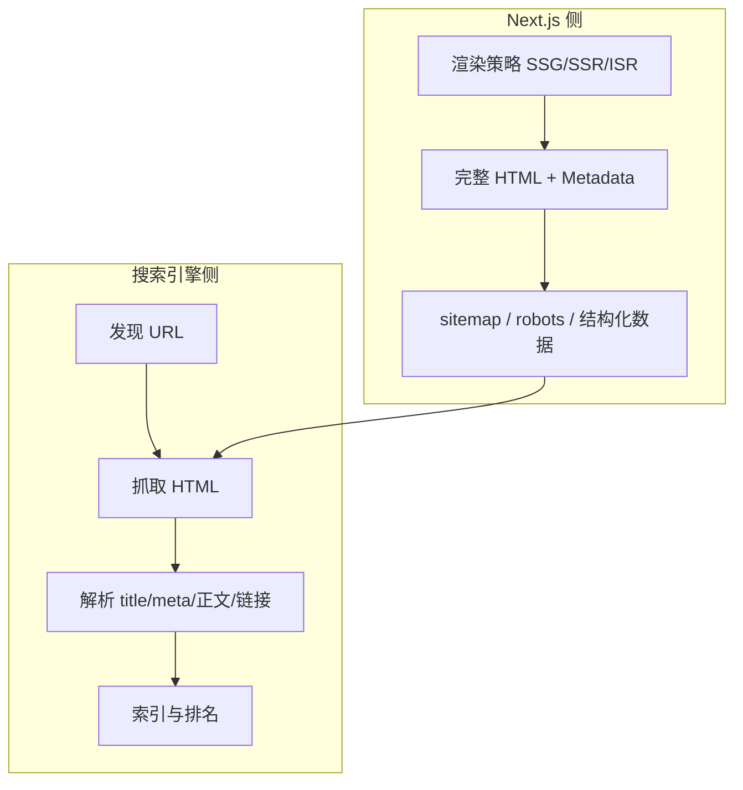
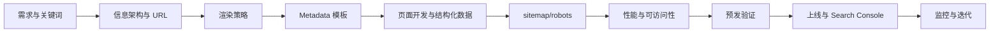

# Next.js SEO 优化与实践流程

本篇目标：梳理 **搜索引擎如何理解页面**、**Next.js（App Router）提供的 SEO 能力**，以及从 **立项到上线** 的实际开发流程。建议前置：已阅读 [Next.js 知识体系与学习路线](/NextStudy/index)，能区分 SSR / SSG / ISR 与 Server / Client Component。

---

## 一、SEO 与 Next.js 的关系

&emsp;&emsp;**SEO（Search Engine Optimization）** 的目标是让搜索引擎能 **发现、抓取、理解、索引** 你的页面，并在合适查询下获得合理排名。对 Web 应用而言，核心不只是「写 meta 标签」，还包括：**可抓取的 HTML**、**清晰的 URL 与站点结构**、**性能与体验（Core Web Vitals）**、**结构化数据** 等。

&emsp;&emsp;**纯 CSR（单页应用）的常见短板：**

| 问题 | 表现 |
| --- | --- |
| 首屏 HTML 内容少 | 爬虫可能只看到空壳或延迟渲染的内容 |
| Meta 由 JS 动态写入 | 部分爬虫不执行 JS 或执行不完整 |
| 分享预览差 | 社交平台抓取时缺少 Open Graph |

&emsp;&emsp;**Next.js 的默认优势：** Server Component 在服务端输出 **带正文与 meta 的 HTML**；App Router 提供 **Metadata API**、`sitemap` / `robots` 约定文件；配合 SSG / ISR 可兼顾 **SEO 与性能**。仍需避免：整页 `'use client'`、关键文案只在客户端 `useEffect` 里渲染、登录墙挡住公开页等。



---

## 二、渲染策略如何选（SEO 视角）

&emsp;&emsp;**原则：** 需要被索引的 **公开内容页**，应尽量在 **服务端或构建时** 生成完整 HTML；强个性化、实时且无需 SEO 的区域再用 CSR。

| 页面类型 | 推荐策略 | App Router 常见写法 |
| --- | --- | --- |
| 首页、关于、定价 | SSG 或 ISR | 默认 `fetch` 缓存 / `revalidate` |
| 博客、文档、商品详情 | SSG + `generateStaticParams` 或 ISR | 动态路由预生成 |
| 搜索结果、用户仪表盘 | SSR 或 CSR + `noindex` | `dynamic = 'force-dynamic'` |
| 纯交互工具（计算器） | CSR 可接受 | 若需收录则保留 SSR 壳 + 说明文案 |

```tsx
// app/blog/[slug]/page.tsx — ISR：内容更新后定期再生
export const revalidate = 3600 // 1 小时

export async function generateStaticParams() {
  const posts = await getPostSlugs() // 构建时预生成路径
  return posts.map((slug) => ({ slug }))
}

export default async function PostPage({
  params,
}: {
  params: Promise<{ slug: string }>
}) {
  const { slug } = await params
  const post = await getPost(slug)
  return (
    <article>
      <h1>{post.title}</h1>
      <div dangerouslySetInnerHTML={{ __html: post.bodyHtml }} />
    </article>
  )
}
```

&emsp;&emsp;**验证方式：** 生产构建后 `curl -s https://你的域名/某页 | head` 或浏览器 **查看网页源代码**，确认 `<title>`、`<meta name="description">`、正文 `<h1>` 与列表链接 **已在 HTML 中**，而非仅空 `<div id="root">`。

---

## 三、Metadata API（核心配置）

&emsp;&emsp;App Router 在 **`layout.tsx` / `page.tsx`** 中通过 **`export const metadata`**（静态）或 **`generateMetadata()`**（动态）生成 `<head>` 标签。Next 会 **去重、合并** 父子 layout 的 metadata。

### 1、静态 metadata（营销页、固定标题）

```tsx
// app/layout.tsx
import type { Metadata } from 'next'

const siteUrl = process.env.NEXT_PUBLIC_SITE_URL ?? 'https://example.com'

export const metadata: Metadata = {
  metadataBase: new URL(siteUrl), // 相对 OG 图片、canonical 的基准 URL
  title: {
    default: '我的产品 — 一句话价值',
    template: '%s | 我的产品', // 子页 title 自动套模板
  },
  description: '面向搜索引擎与用户的一段准确描述，建议 120～160 字。',
  keywords: ['可选', '不宜堆砌'],
  authors: [{ name: '团队名' }],
  openGraph: {
    type: 'website',
    locale: 'zh_CN',
    url: siteUrl,
    siteName: '我的产品',
    title: '我的产品 — 一句话价值',
    description: '与 description 一致或略短',
    images: [{ url: '/og/default.png', width: 1200, height: 630, alt: '品牌图' }],
  },
  twitter: {
    card: 'summary_large_image',
    title: '我的产品',
    description: '分享文案',
    images: ['/og/default.png'],
  },
  robots: {
    index: true,
    follow: true,
    googleBot: { index: true, follow: true },
  },
  alternates: {
    canonical: '/', // 子页在 page 里覆盖为完整路径
  },
}

export default function RootLayout({ children }: { children: React.ReactNode }) {
  return (
    <html lang="zh-CN">
      <body>{children}</body>
    </html>
  )
}
```

&emsp;&emsp;**注意：** 根 layout 设置 **`lang="zh-CN"`**；`metadataBase` 在生产环境务必指向 **正式域名**，否则 OG URL、canonical 会错。

### 2、动态 `generateMetadata`（详情页、CMS）

```tsx
// app/blog/[slug]/page.tsx
import type { Metadata } from 'next'

type Props = { params: Promise<{ slug: string }> }

export async function generateMetadata({ params }: Props): Promise<Metadata> {
  const { slug } = await params
  const post = await getPost(slug)
  if (!post) return { title: '文章不存在' }

  const url = `/blog/${slug}`
  return {
    title: post.title,
    description: post.excerpt,
    alternates: { canonical: url },
    openGraph: {
      type: 'article',
      url,
      publishedTime: post.publishedAt,
      modifiedTime: post.updatedAt,
      authors: [post.author.name],
      images: post.cover ? [{ url: post.cover, alt: post.title }] : undefined,
    },
  }
}
```

### 3、不应被索引的页面

```tsx
// app/dashboard/layout.tsx 或某 page
export const metadata: Metadata = {
  robots: { index: false, follow: false },
}
```

&emsp;&emsp;登录页、后台、草稿预览、带 `?` 的重复内容页等，使用 **`noindex`**；必要时配合 **canonical** 指向主 URL。

---

## 四、sitemap 与 robots

&emsp;&emsp;Next.js 13+ App Router 支持约定文件（运行时可动态生成）：

### 1、`app/sitemap.ts`

```tsx
// app/sitemap.ts
import type { MetadataRoute } from 'next'

export default async function sitemap(): Promise<MetadataRoute.Sitemap> {
  const base = process.env.NEXT_PUBLIC_SITE_URL!
  const posts = await getAllPosts()

  const staticRoutes: MetadataRoute.Sitemap = [
    { url: base, lastModified: new Date(), changeFrequency: 'weekly', priority: 1 },
    { url: `${base}/about`, lastModified: new Date(), changeFrequency: 'monthly', priority: 0.8 },
  ]

  const postRoutes = posts.map((p) => ({
    url: `${base}/blog/${p.slug}`,
    lastModified: new Date(p.updatedAt),
    changeFrequency: 'weekly' as const,
    priority: 0.7,
  }))

  return [...staticRoutes, ...postRoutes]
}
```

### 2、`app/robots.ts`

```tsx
// app/robots.ts
import type { MetadataRoute } from 'next'

export default function robots(): MetadataRoute.Robots {
  const base = process.env.NEXT_PUBLIC_SITE_URL!
  return {
    rules: [
      { userAgent: '*', allow: '/', disallow: ['/api/', '/dashboard/', '/admin/'] },
    ],
    sitemap: `${base}/sitemap.xml`,
  }
}
```

&emsp;&emsp;上线后在 [Google Search Console](https://search.google.com/search-console) 提交 sitemap；大站可拆 **sitemap 索引**（多文件），或按 locale 分文件。

---

## 五、结构化数据（JSON-LD）

&emsp;&emsp;帮助搜索引擎理解 **文章、商品、组织、面包屑** 等，可能获得富媒体结果（非保证）。在 **Server Component** 中输出 `<script type="application/ld+json">`。

```tsx
// app/blog/[slug]/page.tsx 片段
function ArticleJsonLd({ post }: { post: Post }) {
  const json = {
    '@context': 'https://schema.org',
    '@type': 'Article',
    headline: post.title,
    description: post.excerpt,
    datePublished: post.publishedAt,
    dateModified: post.updatedAt,
    author: { '@type': 'Person', name: post.author.name },
    image: post.cover ? [post.cover] : undefined,
  }
  return (
    <script
      type="application/ld+json"
      dangerouslySetInnerHTML={{ __html: JSON.stringify(json) }}
    />
  )
}
```

&emsp;&emsp;用 [Google 富媒体结果测试](https://search.google.com/test/rich-results) 校验；字段需与页面可见内容 **一致**，避免虚假评分、虚假价格。

---

## 六、页面结构与内容 SEO（与框架无关但必做）

&emsp;&emsp;**语义化 HTML：** 每页一个 **`h1`**，层级 `h2` → `h3`；用 `<main>`、`<nav>`、`<article>`、`<footer>`。

&emsp;&emsp;**内部链接：** 用 **`next/link`** 链到重要栏目与相关文章，保证 **爬虫可跟链**（勿用仅 `onClick` 跳转而无 `href`）。

&emsp;&emsp;**URL 设计：** 短、可读、含关键词但别堆砌；动态路由用 **slug** 而非纯数字 ID（数字 ID 也可，但 slug 更友好）。

&emsp;&emsp;**图片：** `next/image` + 有意义的 **`alt`**；大图影响 LCP，优先优化首屏 hero。

&emsp;&emsp;**国际化：** 多语言站点配置 **`alternates.languages`（hreflang）** 与独立 URL 前缀（如 `/en`、`/zh`），避免重复内容无标注。

---

## 七、性能与 Core Web Vitals（影响 SEO）

&emsp;&emsp;Google 将 **体验信号** 纳入排名因素之一。Next.js 常用手段：

| 指标 | 含义 | Next 常见优化 |
| --- | --- | --- |
| **LCP** | 最大内容绘制 | 优先加载首屏图、`priority` on Image、SSR 正文 |
| **INP / FID** | 交互延迟 | 缩小 Client 边界、代码分割、避免长任务 |
| **CLS** | 布局偏移 | `next/font`、`width/height`、预留骨架 |

&emsp;&emsp;**实践：** 公开页尽量少 `'use client'`；第三方脚本用 **`next/script`** 的 `strategy="lazyOnload"`；分析 bundle（ `@next/bundle-analyzer` ）。

---

## 八、常见踩坑（App Router）

| 踩坑 | 后果 | 处理 |
| --- | --- | --- |
| 整页 Client Component | HTML 薄、meta 难同步 | 页面默认 Server，交互拆子组件 |
| 标题在 `useEffect` 里改 `document.title` | 爬虫可能看不到 | 用 Metadata / generateMetadata |
| 未设 `metadataBase` | OG 图片 URL 错误 | 根 layout 设正式域名 |
| 重复 URL（www / 非 www、http / https） | 分散权重 | 301 统一 + canonical |
| 分页 `?page=2` 全可索引 | 薄内容重复 | `rel="canonical"` 或 `noindex` 策略 |
| `output: 'export'` 却依赖动态 SSR | 构建或 SEO 预期不符 | 静态导出仅适合纯静态站 |

&emsp;&emsp;**Pages Router 项目：** 仍可使用 `next/head` 或 **`next-seo`**；数据页用 `getStaticProps` / `getServerSideProps` 保证 HTML。新项目统一 App Router 即可。

---

## 九、实际开发流程（推荐 checklist）

&emsp;&emsp;以下流程适合 **营销站 + 内容站 + 部分动态业务** 的典型 Next 项目，可按 sprint 裁剪。



### 阶段 1：规划（与产品/运营对齐）

1. 列出 **需要收录的 URL 清单**（首页、分类、详情、落地页）。
2. 每类页面定 **主关键词、title 模板、description 规范**（避免全站同一 description）。
3. 确定 **多语言、www 策略、是否带 trailing slash**（与 `trailingSlash` 配置一致）。

### 阶段 2：工程基线

1. 配置 **`NEXT_PUBLIC_SITE_URL`**（生产、预发分离）。
2. 根 **`layout.tsx`**：`metadataBase`、`title.template`、`lang`、默认 OG。
3. 新增 **`app/sitemap.ts`**、**`app/robots.ts`**。
4. 约定 **CMS / API 字段**：`title`、`excerpt`、`slug`、`cover`、`updatedAt` 供 `generateMetadata` 使用。

### 阶段 3：页面实现

1. 公开内容页：**Server Component + 服务端取数**。
2. 动态路由：**`generateStaticParams`**（能预生成则预生成）+ **`generateMetadata`**。
3. 列表页：服务端渲染 **可爬链接**（分页用 `<Link href>`）。
4. 需要 JSON-LD 的模板（Article、Product、BreadcrumbList）做成 **可复用 Server 组件**。
5. 后台、API、预览：**`robots: noindex`**。

### 阶段 4：质量门禁（合并前 / 上线前）

| 检查项 | 工具 / 方法 |
| --- | --- |
| 标题与 description 是否唯一、长度合理 | 脚本或表格评审 |
| 查看源代码是否有正文与 meta | 浏览器「查看网页源代码」 |
| OG / Twitter 预览 | [opengraph.xyz](https://www.opengraph.xyz/) 等 |
| 结构化数据 | Google 富媒体测试 |
| Lighthouse SEO 与 Performance | Chrome DevTools |
| 移动端友好 | Search Console + 真机 |
| 404 / 301 | 死链检查、旧 URL 重定向表 |

### 阶段 5：上线与运营

1. 部署生产，确认 **HTTPS、301 到规范域名**。
2. Search Console **添加资源**、提交 **sitemap**、请求重点 URL 索引（按需）。
3. 监控 **覆盖率、Core Web Vitals、查询词**；内容更新时依赖 **ISR / revalidatePath** 保持新鲜度。

---

## 十、最小可运行示例（目录示意）

```text
app/
├── layout.tsx              # metadataBase、默认 metadata
├── page.tsx                  # 首页 metadata（可覆盖 title）
├── about/page.tsx
├── blog/
│   ├── page.tsx              # 列表：服务端渲染链接
│   └── [slug]/page.tsx       # generateMetadata + JSON-LD
├── sitemap.ts
├── robots.ts
└── (dashboard)/              # 路由组
    └── layout.tsx            # robots: noindex
lib/
├── posts.ts                  # getPost、getAllPosts、getPostSlugs
public/
└── og/
    └── default.png           # 1200×630
.env.production
# NEXT_PUBLIC_SITE_URL=https://www.example.com
```

---

## 十一、常见问题

**Q1：`generateMetadata` 里 fetch 会和页面重复请求吗？**

&emsp;&emsp;同一请求周期内，对相同 URL 使用 Next 的 **`fetch` 缓存** 或 **`React.cache()` 包装的数据层**，通常会自动去重。建议把「按 slug 取文章」封装成单一函数供 metadata 与 page 共用。

**Q2：客户端路由切换后 SEO 会变吗？**

&emsp;&emsp;用户侧 SPA 导航时，Next 会更新 **document title 与 meta**（客户端）；**首次抓取仍以服务端返回的 HTML 为准**。重要页面要保证 **直接访问 URL** 时 metadata 正确。

**Q3：要不要用 `next-seo`？**

&emsp;&emsp;App Router 官方 **Metadata API** 已覆盖大部分场景；`next-seo` 在 Pages Router 更常见。App Router 优先原生 API，减少重复抽象。

**Q4：预览环境怕被收录？**

&emsp;&emsp;预发域名在 **`robots.ts` 全文 disallow** 或全站 **`noindex`**；勿与生产共用可被外链指向的域名。

---

## 十二、知识自检与延伸阅读

| 知识点 | 能否解释？ | 能否在项目中落地？ |
| --- | --- | --- |
| 为何 SSR/SSG 利于 SEO | ☐ | ☐ |
| `metadata` vs `generateMetadata` | ☐ | ☐ |
| `metadataBase` 与 canonical | ☐ | ☐ |
| sitemap.ts / robots.ts | ☐ | ☐ |
| JSON-LD 与可见内容一致 | ☐ | ☐ |
| 公开页 vs noindex 策略 | ☐ | ☐ |
| 源代码验证与 Lighthouse | ☐ | ☐ |

- [Next.js Metadata 文档](https://nextjs.org/docs/app/building-your-application/optimizing/metadata)
- [Next.js Sitemap](https://nextjs.org/docs/app/api-reference/file-conventions/metadata/sitemap)
- [Next.js Robots](https://nextjs.org/docs/app/api-reference/file-conventions/metadata/robots)
- [Google 搜索中心文档](https://developers.google.com/search/docs)

&emsp;&emsp;与 [Next.js 知识体系与学习路线](/NextStudy/index) 中的 **渲染模式、动态路由、Metadata** 章节对照学习，可在真实项目中把 SEO 作为 **每一张公开 page 的 Definition of Done** 之一，而不是上线前一次性补 meta。
