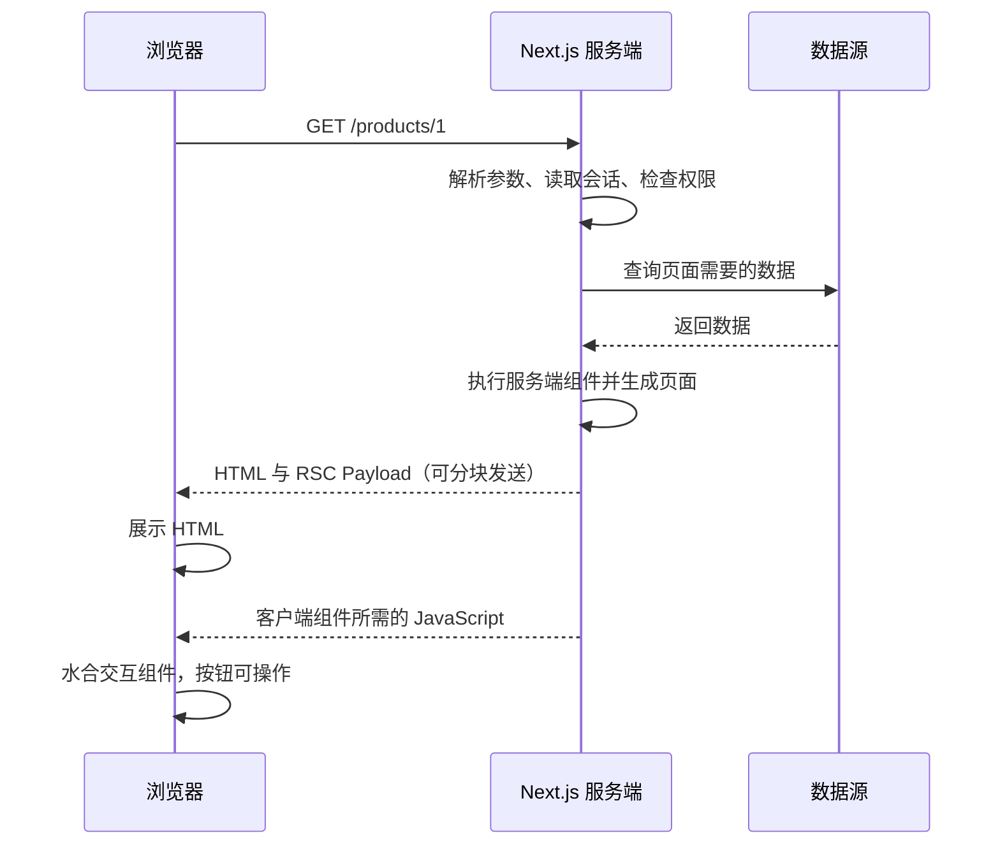

# Next.js SSR 开发指南：原理、实战流程与常见问题

本篇目标：从「一次请求如何生成页面」出发，梳理 **Next.js SSR 的使用场景、项目搭建、服务端取数、客户端交互、缓存、鉴权、部署与排错**。建议先了解 [Next.js 基础](/NextStudy/index)，需要处理搜索收录时结合 [SEO 实践](/NextStudy/seo) 阅读。

> **版本范围与示例约定（核对日期：2026-10-22）**
>
> - 主线采用 **Next.js 16.x、App Router、TypeScript、Node.js 运行时**；项目应锁定实际依赖版本并提交 lockfile。
> - 第四节的完整示例明确设置 `cacheComponents: false`，便于先理解按请求渲染。第七节单独介绍启用 Cache Components 后的写法。
> - 使用异步的 `params`、`searchParams`、`cookies()` / `headers()`；不要直接照搬旧版本的同步访问示例。
> - 本篇是开发教程。当前仓库是 VitePress 文档站，下面的 `app/`、`lib/` 等代码应放到**单独创建的 Next.js 项目**中。

---

## 一、先理解 SSR 到底解决什么问题

### 1、SSR、SSG、ISR 与 CSR

**SSR（Server-Side Rendering）** 指服务端在收到请求后生成页面内容。浏览器拿到 HTML 就能展示正文，再加载 JavaScript 完成交互。

- **SSR：** 按请求生成，适合登录后的订单、按查询条件生成的结果、需要及时读取的数据。
- **SSG：** 构建时生成，适合变化较少的文档、介绍页。
- **ISR：** 在静态生成基础上按时间或事件更新，适合允许短暂陈旧的公开内容。
- **CSR：** 浏览器获取数据并渲染，适合地图操作、后台筛选面板、实时轮询等交互区域。

选择时先问：**数据是否因用户而异？允许旧多久？是否必须随首屏 HTML 一起到达？** 同一个应用可以按页面甚至按区域组合使用这些策略，不需要整站都做 SSR。

SSR 有服务端取数和渲染成本；后端很慢时，首字节也可能很慢。是否改善体验，需要结合数据延迟、缓存和实际指标判断，不能只看「用了 SSR」。

### 2、Server Component 不等于每次请求 SSR

App Router 的页面和布局默认是 Server Component。这说明**组件代码在服务端执行**，但执行时间可能是构建时、缓存再验证时，也可能是请求时。

同样，`'use client'` 表示客户端模块边界，**不代表首次访问时完全不生成服务端 HTML**。首次完整加载中，Client Component 通常也会参与 HTML 预渲染，然后在浏览器水合；后续客户端导航的处理不同。因此，即使写了 `'use client'`，也不能在渲染阶段随意读取 `window`。

Server Component 负责数据和页面结构，Client Component 负责状态、事件及浏览器能力；普通 Server Component 本身不在浏览器执行水合。详见 [Server and Client Components](https://nextjs.org/docs/app/getting-started/server-and-client-components)。

### 3、一次首次访问的过程



RSC Payload 是 React 描述服务端组件结果及客户端组件引用的数据格式。通过 `<Link>` 进行站内导航时，可能使用预取或缓存的 Payload，也可能向服务端请求新的 Payload；**不一定重新下载完整 HTML 文档**。

---

## 二、实际开发先做哪些决定

建议把需求转换为下面的开发步骤，再开始写页面：

1. **明确首屏内容。** 商品名称、价格、订单状态等哪些必须由服务端给出？哪些可以稍后加载？
2. **定义数据新鲜度。** 库存、订单等关键数据是否必须现查？文章和分类是否可缓存？
3. **定义访问权限。** 是否登录可见？是否只能查看自己的记录？接口由谁完成最终授权？
4. **选择路由体系。** 新项目按 App Router 开发；维护 `pages/` 项目时使用其数据获取机制。
5. **拆分组件。** 页面与数据访问放在服务端；按钮、表单状态、图表交互拆到较小的 Client Component。
6. **补齐页面状态。** 正常、空数据、不存在、未登录、无权限、接口失败、加载中，都要有处理方式。
7. **确定部署方式。** 按请求 SSR 必须有服务端运行环境，不能只上传静态 HTML。

例如商品详情页可以这样划分：商品资料允许缓存，库存按请求读取，收藏按钮是客户端交互，购买动作由服务端再次检查库存和权限。**首屏展示价格与最终成交校验是两个不同环节。**

---

## 三、创建项目与整理目录

### 1、创建独立的 Next.js 项目

在准备放置新项目的目录运行以下命令，不要在当前文档仓库中直接安装 Next.js：

```bash
pnpm create next-app@latest next-ssr-demo
cd next-ssr-demo
pnpm add server-only
pnpm dev
```

交互选项选择 TypeScript、App Router、默认 `@/*` 别名；本例不使用 `src/` 目录，Cache Components 先选择关闭。若选择了 `src/`，后续将 `app/`、`components/`、`lib/` 一起放进 `src/`。

Node.js 需满足所选 Next.js 版本要求；核对时官方最低要求为 **20.9**。正式项目应使用仍受维护、且满足要求的 Node.js 版本。`@latest` 用于初始化，后续通过 lockfile 固定依赖。参见 [安装说明](https://nextjs.org/docs/app/getting-started/installation)。

### 2、完整示例的目录

```text
next-ssr-demo/
├─ app/
│  ├─ layout.tsx
│  ├─ page.tsx
│  └─ products/
│     └─ [id]/
│        ├─ page.tsx
│        ├─ loading.tsx
│        ├─ error.tsx
│        └─ not-found.tsx
├─ components/
│  └─ quantity-picker.tsx
├─ lib/
│  └─ products.ts
└─ next.config.ts
```

- `page.tsx` 暴露页面路由，`layout.tsx` 放共享布局。
- `loading.tsx` 提供路由段的加载状态。
- `error.tsx` 捕获下层渲染异常，必须是 Client Component。
- `not-found.tsx` 提供资源不存在时的界面。
- `lib/` 放数据访问函数，避免页面与接口各维护一份业务逻辑。

---

## 四、完整示例：按请求渲染商品详情

本例先用本地只读数据跑通链路，**无需数据库、登录服务或外部接口**。每次完整请求会生成新的服务端时间，用来观察按请求执行；商品资料本身是固定的演示数据。

### 1、明确缓存模式

```ts
// next.config.ts
import type { NextConfig } from 'next'

const nextConfig: NextConfig = {
  cacheComponents: false,
}

export default nextConfig
```

### 2、准备服务端数据访问层

```ts
// lib/products.ts
import 'server-only'

export type Product = {
  id: string
  name: string
  description: string
  priceInCents: number
}

const products: Product[] = [
  {
    id: '1',
    name: '机械键盘',
    description: '用于演示服务端取数和客户端交互。',
    priceInCents: 29900,
  },
]

export async function getProduct(id: string): Promise<Product | null> {
  // 这里是演示数据；实际项目替换为数据库查询或后端 API。
  return products.find((product) => product.id === id) ?? null
}
```

`server-only` 可以阻止该模块被客户端模块误导入，但**不会自动过滤你传给客户端的数据**。给 UI 的字段仍需主动选择，尤其不要返回完整数据库用户对象。参见 [数据安全指南](https://nextjs.org/docs/app/guides/data-security)。

### 3、保留根布局并添加入口

```tsx
// app/layout.tsx
import type { ReactNode } from 'react'

export default function RootLayout({ children }: { children: ReactNode }) {
  return (
    <html lang="zh-CN">
      <body>{children}</body>
    </html>
  )
}
```

```tsx
// app/page.tsx
import Link from 'next/link'

export default function HomePage() {
  return <Link href="/products/1">查看商品 SSR 示例</Link>
}
```

### 4、服务端页面：取数、404、生成 HTML

```tsx
// app/products/[id]/page.tsx
import type { Metadata } from 'next'
import { notFound } from 'next/navigation'
import { connection } from 'next/server'
import QuantityPicker from '@/components/quantity-picker'
import { getProduct } from '@/lib/products'

export const metadata: Metadata = {
  title: '商品详情 | SSR 示例',
  description: '演示 Next.js 按请求渲染和客户端交互。',
}

export default async function ProductPage({
  params,
}: {
  params: Promise<{ id: string }>
}) {
  // 显式等待真实请求，避免演示数据在构建时就生成固定页面。
  await connection()

  const { id } = await params
  if (!/^\d+$/.test(id)) notFound()

  const product = await getProduct(id)
  if (!product) notFound()

  const renderedAt = new Date().toISOString()

  return (
    <main>
      <h1>{product.name}</h1>
      <p>{product.description}</p>
      <p>单价：¥{(product.priceInCents / 100).toFixed(2)}</p>
      <p>本次服务端渲染时间：{renderedAt}</p>
      <QuantityPicker unitPriceInCents={product.priceInCents} />
    </main>
  )
}
```

`connection()` 把后续执行延迟到请求到达之后，适合此类没有请求 API、但明确需要按请求生成的内容。它**不负责清空其他显式缓存**。如果页面已经读取 `cookies()` 等请求数据，通常不必额外调用它。参见 [connection API](https://nextjs.org/docs/app/api-reference/functions/connection)。

`params` / `searchParams` 在本篇版本中都按 Promise 处理；读取查询条件时使用 `await searchParams`，注意参数可能是字符串、字符串数组或 `undefined`，需要校验后再传给查询函数。参见 [page API](https://nextjs.org/docs/app/api-reference/file-conventions/page)。

### 5、客户端组件：只负责交互

```tsx
// components/quantity-picker.tsx
'use client'

import { useState } from 'react'

export default function QuantityPicker({
  unitPriceInCents,
}: {
  unitPriceInCents: number
}) {
  const [quantity, setQuantity] = useState(1)

  return (
    <section aria-label="选择数量">
      <button
        type="button"
        disabled={quantity === 1}
        onClick={() => setQuantity((value) => Math.max(1, value - 1))}
      >
        减少
      </button>
      <span> 数量：{quantity} </span>
      <button type="button" onClick={() => setQuantity((value) => value + 1)}>
        增加
      </button>
      <p>合计：¥{((unitPriceInCents * quantity) / 100).toFixed(2)}</p>
    </section>
  )
}
```

这里从服务端传给客户端的只有价格数字。金额采用整数分，避免直接把小数金额相乘产生精度问题。这个合计只是界面展示；真正下单时，服务端应重新查询单价并校验数量。

### 6、加载、异常与不存在

```tsx
// app/products/[id]/loading.tsx
export default function Loading() {
  return <p role="status">正在加载商品……</p>
}
```

```tsx
// app/products/[id]/error.tsx
'use client'

export default function ErrorPage() {
  return (
    <section role="alert">
      <h2>商品暂时无法加载</h2>
      <button type="button" onClick={() => window.location.reload()}>
        重新加载
      </button>
    </section>
  )
}
```

这里使用整页重载，便于在不同小版本中复现。若希望只重试当前路由段，请按安装版本的 `error.tsx` API 使用恢复回调；核对时最新文档使用 `retry()`，较早的教程常见 `reset()`。不要把内部堆栈或后端响应全文直接展示给用户。参见 [错误处理](https://nextjs.org/docs/app/getting-started/error-handling)。

```tsx
// app/products/[id]/not-found.tsx
export default function NotFound() {
  return <h1>商品不存在或已下架</h1>
}
```

访问 `/products/1` 查看正常内容，访问 `/products/999` 查看不存在状态。当前只读数据不会主动触发接口异常；验证错误界面时，可在本地临时让 `getProduct` 抛错，验证后恢复。

---

## 五、接入真实 API 或数据库

### 1、已有独立后端：服务端直接请求可信数据源

将第四节 `getProduct` 的实现替换为以下版本，保留 `Product` 类型，增加环境配置：

```dotenv
# .env.local；部署环境也要配置。此域名只是占位，必须替换。
API_BASE_URL=https://api.example.com/
```

假定接口为 `GET /products/:id`，返回结构与 `Product` 一致；资源不存在返回 404：

```ts
// lib/products.ts 中的真实接口实现
// 文件顶部保留 import 'server-only' 和 Product 类型。
function isProduct(value: unknown): value is Product {
  if (typeof value !== 'object' || value === null) return false
  const item = value as Record<string, unknown>
  return (
    typeof item.id === 'string' &&
    typeof item.name === 'string' &&
    typeof item.description === 'string' &&
    typeof item.priceInCents === 'number' &&
    Number.isSafeInteger(item.priceInCents) &&
    item.priceInCents >= 0
  )
}

export async function getProduct(id: string): Promise<Product | null> {
  const baseUrl = process.env.API_BASE_URL
  if (!baseUrl) throw new Error('缺少 API_BASE_URL 配置')

  const url = new URL(`/products/${encodeURIComponent(id)}`, baseUrl)
  const response = await fetch(url, {
    cache: 'no-store',
    signal: AbortSignal.timeout(5000),
  })

  if (response.status === 404) return null
  if (!response.ok) {
    throw new Error(`商品接口请求失败：${response.status}`)
  }

  const data: unknown = await response.json()
  if (!isProduct(data)) throw new Error('商品接口返回结构异常')
  return data
}
```

实际 API 若返回 `{ data: ... }`，需先解包再校验。超时、非 2xx、非法 JSON 与结构不符都属于异常，交给错误边界处理；**不要全部转换为 404**，否则会把服务故障伪装成资源不存在。`fetch` 遇到 HTTP 500 不会自动抛错，必须检查 `response.ok`。

注意此处 `new URL` 以 `/products/` 开头，会使用域名根路径；若后端带 `/api/v1/` 前缀，应按实际接口调整。数据源地址由服务端配置控制，不要直接把用户输入当作可请求的目标 URL。

### 2、自己维护数据库：在数据访问层查询

Server Component 可以调用服务端数据库客户端，无需先绕一圈本项目的 `/api`。将连接与查询封装在 `lib/`，数据库凭据只存在服务端；生产环境还应结合部署模式配置连接池。

**页面和 Route Handler 共享数据访问函数**，而不是页面通过 HTTP 调用自己的 Route Handler。后者增加网络往返，且静态预渲染阶段未必存在可供调用的应用服务。Route Handler 更适合浏览器、移动端、第三方回调等 HTTP 调用方。参见 [Backend for Frontend 指南](https://nextjs.org/docs/app/guides/backend-for-frontend)。

### 3、避免串行请求瀑布

```ts
// 示意：这两个请求互不依赖时，同时启动。
const [product, recommendations] = await Promise.all([
  getProduct(id),
  getRecommendations(id),
])
```

`getRecommendations` 表示项目自己的推荐查询函数。如果推荐失败不应影响商品主体，可以给推荐区单独处理异常和 Suspense；`Promise.all` 中任意任务拒绝都会使整体失败。若后一个查询必须依赖前一个查询结果，则顺序执行是合理的。参见 [数据获取](https://nextjs.org/docs/app/getting-started/fetching-data)。

---

## 六、SSR 的缓存策略：先明确缓存哪一层

### 1、按请求渲染与每次查源站是两回事

动态页面仍可以复用某些缓存数据。例如「缓存的商品介绍 + 当前用户的实时购物车」可以组合出个性化页面。

排查数据陈旧时，按顺序确认：

1. **请求内去重：** 同一次渲染中复用相同读取结果，常见于 GET `fetch` 的记忆化或 `React.cache`。
2. **跨请求数据缓存：** 服务端复用 fetch 或函数的缓存结果。
3. **路由输出缓存：** 预渲染的 HTML、RSC 结果或静态壳是否被复用。
4. **客户端导航缓存：** 预取、回退、布局复用等可能使导航不重新执行全部服务端逻辑。
5. **浏览器 / CDN / 上游缓存：** 即使 Next.js 重新请求，也可能拿到上游的旧响应。

不要把 `React.cache` 当作跨用户、跨请求的持久缓存。在服务端组件渲染中，它主要用于当前请求内复用函数结果。相关机制参见 [数据获取与请求内复用](https://nextjs.org/docs/app/getting-started/fetching-data)。

### 2、未启用 Cache Components 时的 fetch

主线示例关闭 Cache Components，下面显式表达每个请求的意图：

```ts
// 每次访问数据源：库存、个人订单等。
await fetch(url, { cache: 'no-store' })

// 跨请求缓存：公开且允许复用的数据。
await fetch(url, { cache: 'force-cache' })

// 允许缓存，并设置再验证周期：公开分类等。
await fetch(url, { next: { revalidate: 60 } })
```

当前文档说明 `fetch` 默认不持久缓存，但没有请求期依赖的路由仍可能在构建时预渲染。因此，**「省略 cache」不能作为证明每次访问都 SSR 的依据**。同时，不要给同一个 fetch 设置 `cache: 'no-store'` 和正数 `next.revalidate`，两者意图冲突。

`revalidate: 60` 也不是每 60 秒主动推送到所有浏览器；它控制服务端缓存的再验证，页面更新还取决于下一次访问等因素。详见 [fetch API](https://nextjs.org/docs/app/api-reference/functions/fetch) 与 [未启用 Cache Components 的缓存指南](https://nextjs.org/docs/app/guides/caching-without-cache-components)。

### 3、刷新页面与失效缓存需要分别处理

- `router.refresh()`：客户端请求当前路由的新服务端结果，不会自动清除服务端持久缓存。
- `revalidatePath()`：服务端让指定路径相关缓存重新验证，常用于数据写入之后。
- 标签更新：根据当前版本使用 `revalidateTag` / `updateTag`；需要区分允许旧值的后台再验证与写后立即读新值的需求。

如果源数据一直被缓存，单独调用 `router.refresh()` 仍可能得到旧数据。反过来，只更新服务端缓存，也不等于所有已打开页面都立即收到推送。参见 [useRouter](https://nextjs.org/docs/app/api-reference/functions/use-router) 和 [缓存再验证](https://nextjs.org/docs/app/getting-started/revalidating)。

---

## 七、进阶：启用 Cache Components 后如何组织 SSR

**本节是另一种配置模式，不要与第四节配置同时使用。** Cache Components 在同一路由内组合静态壳、缓存内容和请求期内容；启用后，运行时读取通常需要放到合适的 Suspense 边界内。

核对时最新 16.x 配置示例同时显式设置 `partialPrefetching`；不同小版本支持情况可能不同，应按项目安装版本核对 [cacheComponents 配置](https://nextjs.org/docs/app/api-reference/config/next-config-js/cacheComponents)。

```ts
// next.config.ts：支持该配置的新版 16.x 示例
import type { NextConfig } from 'next'

const nextConfig: NextConfig = {
  cacheComponents: true,
  partialPrefetching: true,
}

export default nextConfig
```

下面使用独立路由演示请求期区域，不依赖数据库：

```tsx
// app/runtime-demo/page.tsx
import { Suspense } from 'react'
import { connection } from 'next/server'

async function RequestTime() {
  await connection()
  return <p>请求时间：{new Date().toISOString()}</p>
}

export default function Page() {
  return (
    <main>
      <h1>可以预渲染的页面标题</h1>
      <Suspense fallback={<p>正在生成请求期内容……</p>}>
        <RequestTime />
      </Suspense>
    </main>
  )
}
```

公开且允许缓存的数据函数可使用以下模式；`queryPublicCategories` 表示项目自己的数据查询函数：

```ts
import { cacheLife, cacheTag } from 'next/cache'

async function getPublicCategories() {
  'use cache'
  cacheLife('minutes')
  cacheTag('categories')
  return queryPublicCategories()
}
```

普通共享的 `'use cache'` 范围内不能直接读取 `cookies()`、`headers()` 等请求数据。个人敏感数据先保持请求期读取，别套进公共缓存。旧教程中的 `dynamic = 'force-dynamic'`、路由级 `revalidate` 等配置也不能直接当作此模式的通用开关；迁移时应按安装版本的指南调整。参见 [Cache Components 与缓存](https://nextjs.org/docs/app/getting-started/caching)。

---

## 八、登录态、权限与数据安全

### 1、服务端如何拿到当前用户

浏览器发送当前站点的 Cookie，Server Component 通过 `await cookies()` 读取。服务端再向独立后端发 fetch 时，**不会因为这次请求来自浏览器就自动继承浏览器全部 Cookie**，需要明确传递后端认可的身份信息。

下面是接入已有鉴权系统后的结构示意，`verifySession` 需要由实际鉴权库或会话服务提供：

```ts
// lib/auth.ts（结构示意，不是完整登录系统）
import 'server-only'
import { cache } from 'react'
import { cookies } from 'next/headers'
import { redirect } from 'next/navigation'
import { verifySession } from '@/lib/session'

export const requireUser = cache(async () => {
  const token = (await cookies()).get('session')?.value
  const user = token ? await verifySession(token) : null
  if (!user) redirect('/login')
  return { id: user.id }
})
```

校验要检查会话有效性、签名 / 数据库记录、过期和撤销状态，不能仅凭「Cookie 存在」就信任用户。Cookie 写入应放到 Server Action / Route Handler 等响应处理环节，使用合适的 `HttpOnly`、`Secure`、`SameSite`、有效期等配置；渲染中的 Server Component 用于读取，不负责设置 Cookie。参见 [cookies API](https://nextjs.org/docs/app/api-reference/functions/cookies)。

### 2、权限检查要靠近数据访问

- 个人订单应按已验证的用户身份查询，例如同时限制 `orderId` 与 `userId`。
- 页面隐藏按钮只是界面行为，Server Action 与 Route Handler 都必须重新校验身份、权限和输入。
- 不要只在共享 `layout.tsx` 中检查登录：布局在客户端导航中可能复用，数据访问处仍需授权。
- Proxy（旧版本常称 Middleware）可以做快速入口检查，但不能替代数据层授权。
- 私有响应不要配置为 CDN 的公共共享缓存；验收时至少用两个不同用户检查隔离。

参见 [Authentication 指南](https://nextjs.org/docs/app/guides/authentication)。

### 3、哪些东西会到浏览器

API 密钥应放在服务端环境变量，不能加 `NEXT_PUBLIC_` 前缀。服务端组件代码不会作为普通客户端组件代码下载，但**渲染输出和传给客户端组件的 props 会到浏览器**；隐藏在样式里的内容也已经发送。

不要传递访问令牌、密码摘要或内部数据库对象。对跨边界数据使用明确的 DTO；Client Component 的 props 应满足 React 的可序列化规则，不能直接传数据库连接或普通函数。Pages Router 的 props 则需要满足其 JSON 序列化约束。

---

## 九、写入数据后如何更新 SSR 页面

读请求负责展示，写入操作通过 Server Action 或 Route Handler 执行。以「修改商品」为例，完整链路应是：

1. 用户提交表单，客户端显示 pending，避免重复点击。
2. 服务端重新检查身份、编辑权限以及字段格式。
3. 写入数据库或调用可信后端，处理并发冲突。
4. 如果相关内容有缓存，失效对应路径或标签。
5. 返回新的页面结果或刷新当前路由，让界面与服务端状态一致。

```ts
// app/products/actions.ts（示意，依赖业务项目自己的函数）
'use server'

import { revalidatePath } from 'next/cache'
import { requireEditor } from '@/lib/auth'
import { parseProductUpdate, updateProductForEditor } from '@/lib/product-service'

export async function saveProduct(formData: FormData) {
  const editor = await requireEditor()
  const input = parseProductUpdate(formData)
  await updateProductForEditor(editor.id, input)
  revalidatePath(`/products/${encodeURIComponent(input.id)}`)
}
```

`requireEditor`、`parseProductUpdate`、`updateProductForEditor` 需要自行实现；这个片段展示流程，不属于第四节的可运行最小示例。不能直接信任客户端传来的用户 ID 或成交价格。Server Actions 主要用于数据变更，不要把所有页面查询都改成 Action。参见 [Mutating Data](https://nextjs.org/docs/app/getting-started/mutating-data) 与 [revalidatePath](https://nextjs.org/docs/app/api-reference/functions/revalidatePath)。

---

## 十、Streaming 与性能优化

### 1、先展示可用内容，再等待慢区域

`loading.tsx` 会为对应页面及其下层提供 Suspense 加载界面。若只想让推荐区等待，应在商品主体之外单独包 `<Suspense>`，并把慢查询放进被包裹的异步组件内部。

**不要先在父组件 `await` 完所有慢请求，再包 Suspense**，那样边界已经无法覆盖之前发生的等待。同一层 `loading.tsx` 也不能覆盖该层布局自己发起的慢读取。参见 [Fetching Data](https://nextjs.org/docs/app/getting-started/fetching-data)。

### 2、SSR 不代表自动更快

优先观察这些指标和原因：

- **TTFB 高：** 检查数据库查询、串行调用、冷启动、应用与数据库的地域距离。
- **LCP 高：** 检查首屏主图、字体和主体内容是否被低优先级请求阻塞。
- **INP 差：** 检查客户端 JavaScript 体积、长任务和交互组件计算。
- **服务端成本高：** 给允许陈旧的公共数据缓存，缩小每次必须动态读取的范围。

流式传输能提前展示一部分内容，但不能让数据库查询本身变快。部署后还需检查代理、负载均衡和 CDN 是否缓冲响应；否则本地分块显示，线上可能等到全部完成才出现。参见 [自托管与 Streaming](https://nextjs.org/docs/app/guides/self-hosting)。

### 3、状态码在开始发送后不能任意修改

当 `loading.tsx` 或 Suspense 回退开始输出，响应可能已使用 200 状态。之后再调用 `notFound()`，仍可展示不存在界面并包含相应 `noindex` 信息，但 HTTP 状态可能仍是 200；重定向也可能通过流式内容交给客户端处理。

若业务必须严格返回 404 / 401 / 重定向状态，需要把相应判断安排在响应开始流式输出之前，并检查上层是否已有加载边界。不要只看到「404 页面」就认定网络状态也是 404。参见 [loading.js 的状态码说明](https://nextjs.org/docs/app/api-reference/file-conventions/loading)。

---

## 十一、常见问题与排查顺序

### 1、页面写了 async，为什么仍然像静态页面？

`async` 只表示函数可以等待异步操作，不强制请求期渲染。检查是否有请求期依赖、显式缓存，以及生产构建输出；需要明确按请求执行时，可使用 `connection()` 或正确的请求数据访问方式。

主线示例中的服务端时间可以辅助观察，但 `<Link>` 预取、浏览器回退和 CDN 也会影响结果。优先用两次独立的直接 HTTP 请求验证。

### 2、出现 window is not defined / localStorage is not defined

Client Component 的首次预渲染也可能在服务端发生。把浏览器 API 放到事件回调或 `useEffect`，不要在模块顶层或初次 render 直接读取。

```tsx
'use client'

import { useEffect, useState } from 'react'

export default function SavedPreference() {
  const [theme, setTheme] = useState('light')

  useEffect(() => {
    setTheme(localStorage.getItem('theme') ?? 'light')
  }, [])

  return <p>偏好：{theme}</p>
}
```

这个写法保证服务端与浏览器首次渲染使用相同初始值，但挂载后可能发生视觉切换。若偏好需要影响首屏，应考虑通过 Cookie 在服务端提供一致初值。

### 3、Hydration failed / 服务端与客户端文本不一致

常见原因：渲染时分别执行 `Date.now()` 或 `Math.random()`、两端时区不同、首次输出依赖 `localStorage`、HTML 嵌套不合法，以及插件或 CDN 修改 HTML。

排查顺序是：检查报错组件 → 固定初始数据与格式 → 修正 HTML 结构 → 排查扩展和中间层。第四节的时间在 Server Component 中生成后直接输出；不要在 Client Component 首次 render 再独立计算一个时间来替换它。

`suppressHydrationWarning` 只适用于明确、有限且无法避免的差异，不能当作全局修复。对于确实只支持浏览器的第三方组件，可在 Client Component 内使用 `next/dynamic` 的 `ssr: false`，并提供加载占位；不要顺手关闭整个内容页的 SSR。参见 [Hydration 错误指南](https://nextjs.org/docs/messages/react-hydration-error)。

### 4、服务端 fetch('/api/products') 报 URL 错误

浏览器会相对当前页面解析 URL，服务端 fetch 通常需要绝对地址。若 `/api/products` 就在同一个 Next.js 项目里，优先提取公共查询函数，由 Server Component 和 Route Handler 分别调用。

### 5、接口更新了，页面还是旧数据

先核对后端真实返回，再依次检查 fetch / 函数缓存、路由缓存、客户端导航缓存和 CDN。确认更新操作是否完成，再验证路径或标签是否正确失效。

开发时热更新可能复用服务端 fetch 结果；最终结论应通过生产构建和新请求验证。不要用重复添加随机查询参数替代正式的缓存设计。

### 6、notFound() / redirect() 被当成异常捕获

这类 API 通过框架控制流中断渲染。避免用宽泛的 `try/catch` 包住整个页面并吞掉它们；优先只捕获数据请求本身，之后再进行不存在判断或跳转。

### 7、error.tsx 没有捕获某个错误

它主要捕获下层渲染异常，不负责自动处理点击事件中的异步错误；同一段 `layout.tsx` 的异常需要更上层边界。根布局故障需要考虑 `global-error.tsx`。事件处理器和写入操作应单独处理预期错误并反馈给用户。参见 [错误边界](https://nextjs.org/docs/app/getting-started/error-handling)。

### 8、SSR 是否等于实时推送？

不是。页面渲染完成后，服务端数据变化不会自动更新已经打开的浏览器。需要根据场景使用用户刷新、轮询、SSE 或 WebSocket 等机制。SSR 解决初次展示和服务端读取，持续实时更新需要额外设计。

---

## 十二、Pages Router 老项目如何实现 SSR

`pages/` 使用 `getServerSideProps`，不要把它放到 `app/`；App Router 则直接在 Server Component 取数。下面是**单独的 Pages Router 写法**，可复用第四节 `lib/products.ts` 中的演示数据：

```tsx
// pages/products/[id].tsx
import type { GetServerSideProps, InferGetServerSidePropsType } from 'next'
import { getProduct, type Product } from '@/lib/products'

export const getServerSideProps = (async ({ params, res }) => {
  res.setHeader('Cache-Control', 'private, no-store')
  const id = params?.id
  if (typeof id !== 'string') return { notFound: true }

  const product = await getProduct(id)
  if (!product) return { notFound: true }

  return {
    props: {
      product,
      renderedAt: new Date().toISOString(),
    },
  }
}) satisfies GetServerSideProps<{ product: Product; renderedAt: string }>

export default function ProductPage({
  product,
  renderedAt,
}: InferGetServerSidePropsType<typeof getServerSideProps>) {
  return (
    <main>
      <h1>{product.name}</h1>
      <p>单价：¥{(product.priceInCents / 100).toFixed(2)}</p>
      <p>服务端渲染时间：{renderedAt}</p>
    </main>
  )
}
```

不要同时创建相同 URL 的 `app/products/[id]/page.tsx` 与 `pages/products/[id].tsx`。`getServerSideProps` 在请求时运行，客户端导航到该页时也会经由服务端获取数据；其返回 props 必须可 JSON 序列化。不要直接返回 `Date`、`BigInt` 或数据库实例，应转换为字符串或普通数据。

即使数据只在服务端查询，返回的 props 仍会发送给浏览器，不能携带秘密。参见 [getServerSideProps API](https://nextjs.org/docs/pages/api-reference/functions/get-server-side-props)。

---

## 十三、本地验收与生产部署

### 1、先在 Next.js 示例项目做生产构建

```bash
pnpm exec tsc --noEmit
pnpm build
pnpm start
```

如果配置了 ESLint，再独立运行对应 lint 命令。开发模式通过不等于生产通过；构建阶段会暴露预渲染、环境变量、类型或边界问题。查看构建输出中的路由分类，确认商品示例属于请求期渲染；不同版本的符号以终端图例为准。

以上命令用于新建的 Next.js 项目；**当前文档仓库的 `pnpm build` 只构建 VitePress 文档站**。

### 2、用真实 HTTP 响应验证首屏

在另一个终端执行，Windows PowerShell 使用 `curl.exe` 避免同名别名影响：

```powershell
curl.exe -sS -N http://localhost:3000/products/1
curl.exe -sS -N http://localhost:3000/products/1
curl.exe -i -N http://localhost:3000/products/999
```

检查两次独立请求的正文中是否包含商品名称、价格及不同的服务端时间。流式结果可能分块到达，需等响应完成再检查；不要只截取开头几行。不存在路由要同时检查界面内容与 HTTP 状态，结合前文的 Streaming 状态码规则理解结果。

浏览器中再检查：

- 直接打开与刷新详情页都有正文，数量按钮水合后可操作。
- 从首页 `<Link>` 导航进入详情页正常，控制台没有水合错误。
- 检查原始 HTML 是否包含正文；若还要求禁用 JavaScript 后完整可读，需额外验证 Streaming 的回退内容与后续片段替换行为，不能仅凭「服务端生成」就认定满足该要求。
- 后端慢、超时、500、404、空数据分别得到符合设计的结果。
- 登录项目覆盖未登录、过期会话、越权访问和不同用户间数据隔离。
- 修改数据后，当前页与后续请求遵循预期的更新 / 缓存策略。

### 3、选择能运行 SSR 的环境

可以使用支持 Next.js 的托管平台，或运行 `next build` + `next start` 的 Node.js 服务 / 容器。部署时配置服务端环境变量、健康检查、日志、超时、数据库连接和流式代理；多实例还需考虑共享缓存与失效同步。参见 [自托管指南](https://nextjs.org/docs/app/guides/self-hosting)。

**`output: 'export'` 生成的是静态站点，没有请求期 Next.js 服务，不能承载本篇的动态 SSR。** GitHub Pages 可以托管当前 VitePress 文档或 Next.js 静态导出结果；需要按请求取数和渲染的应用，应部署到具备相应运行时的平台。参见 [静态导出限制](https://nextjs.org/docs/app/guides/static-exports)。

---

## 十四、建议的练习顺序

1. 按第四节完成无外部依赖的详情页，解释服务端时间为什么每次完整请求不同。
2. 替换为真实后端 API，增加超时、响应结构校验、404 和异常处理。
3. 增加登录后的「我的订单」，在数据访问层限制用户可见范围。
4. 给允许陈旧的公共数据增加缓存，再完成一次写入后的失效与刷新。
5. 将慢区域拆成独立 Suspense 边界，比较流式输出与整页等待的差异。
6. 生产构建并部署，验证原始 HTML、客户端导航、权限、缓存和线上性能。

完成这些练习后，应能解释四件事：**哪些代码在服务端执行、哪些内容在请求时生成、哪些结果可以复用、哪些交互仍需浏览器完成。**
