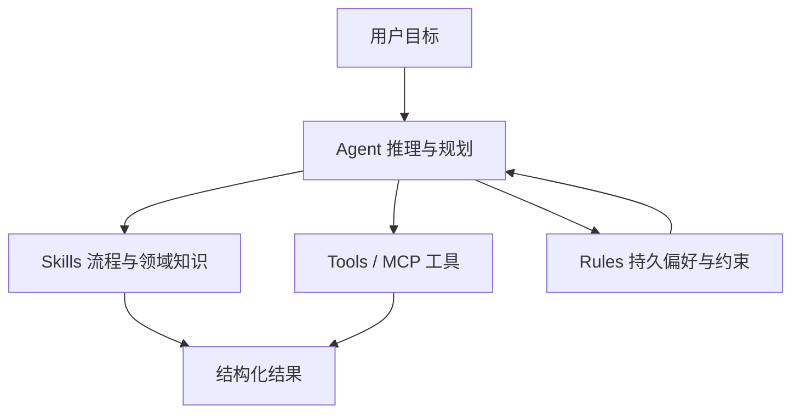

# AI 中的 Skills（技能）

### 1、什么是 Skills？

**Skills（技能）** 是给 AI Agent 用的**可复用、结构化能力包**：通常是一份 Markdown 说明（如 `SKILL.md`），在特定任务场景下被加载，告诉模型**按什么步骤、用什么规范、输出什么格式**去完成某类工作。

可以把它理解成「**专家 SOP + 领域知识 + 可选脚本**」，而不是每次对话都从零写长提示词。

| 对比维度 | 普通 Prompt | Skills |
|----------|-------------|--------|
| 复用性 | 单次对话为主 | 跨项目、跨会话复用 |
| 结构 | 自由文本 | 元数据 + 分节步骤 + 示例 |
| 触发 | 用户手动粘贴 | 描述匹配任务时由 Agent 选用 |
| 范围 | 往往较窄 | 可含参考文档、脚本、检查清单 |

*Skills 解决的是「同一类任务反复做、且要符合团队/产品规范」的问题，例如：按规范写 commit、做安全审查、对接内部 API、生成固定格式的文档。*

---

### 2、Skills 在 Agent 体系里处于什么位置？

Agent 常见能力分层可以简化为：



| 概念 | 作用 | 与 Skills 的关系 |
|------|------|------------------|
| **LLM** | 通用语言与推理 | Skills 提供「在这件事上该怎么想、怎么做」 |
| **Agent** | 感知、规划、调用工具、闭环任务 | Skills 是 Agent 的**专项 playbook** |
| **Tools / MCP** | 读文件、跑命令、调外部 API | Skills 说明**何时、按何顺序**用哪些工具 |
| **Rules** | 全局习惯（语言、代码风格、禁止事项） | Rules 偏「一直生效」；Skills 偏「某类任务才加载」 |
| **RAG / 知识库** | 检索海量文档 | Skills 常是**精炼、可执行**的子集，可与 RAG 配合 |

*Agent ≠ AGI：Skills 让 Agent 在窄领域更稳、更一致，而不是赋予通用人类级智能。*

---

### 3、一个 Skill 通常包含什么？

常见目录结构（以 Cursor 等 IDE Agent 为例）：

```
my-skill/
├── SKILL.md          # 必需：元数据 + 操作说明
├── reference.md      # 可选：详细参考
├── examples.md       # 可选：输入输出样例
└── scripts/          # 可选：校验、转换等脚本
    └── validate.sh
```

**`SKILL.md` 核心组成：**

1. **YAML 头（Frontmatter）**：`name`、`description`（Agent 靠 description 判断何时启用）
2. **Instructions**：分步骤、可执行的流程
3. **Examples**：真实或贴近业务的样例
4. **边界说明**：不适用场景、必须询问用户的情况

示例骨架：

```markdown
---
name: api-error-format
description: >-
  将后端错误响应统一映射为前端展示格式。在用户处理 API 错误、
  对接 BFF 或讨论 error code 时使用。
---

# API 错误格式化

## 何时使用
- 新增接口的错误处理
- 统一 toast / 表单错误文案

## 步骤
1. 读取接口文档中的 error schema
2. 映射为 `{ code, message, fieldErrors? }`
3. 禁止把原始 stack 暴露给用户

## 示例
输入：`{ "error": "VALIDATION", "details": [...] }`
输出：`{ code: "VALIDATION", message: "请检查表单", fieldErrors: {...} }`
```

---

### 4、Skills 的典型使用场景

| 场景 | Skill 里通常写什么 |
|------|-------------------|
| 代码审查 | 检查项清单、严重级别、输出模板 |
| Git / PR | commit 格式、是否 amend、PR 描述结构 |
| 领域工作流 | 「从需求到上线」固定步骤、必问问题 |
| 集成外部系统 | 认证方式、限流、错误码表（精编版） |
| 文档与报告 | 标题层级、术语表、必须包含的章节 |
| 前端专项 | 流式对话状态机、Pinia 会话拆分方式等 |

*与 `index.md` 里「Agent 聚焦任务拆解和工具调用」一致：Skills 正是把「拆解方式」和「质量标准」固化下来。*

---

### 5、如何写好 Description（触发与发现）

Description 会被注入 Agent 的决策上下文，建议同时写清 **WHAT（做什么）** 和 **WHEN（什么时候用）**：

- ✅ 第三人称、具体、带触发词：  
  `Generates Vue 3 composables following project conventions. Use when adding composables, shared hooks, or ref/reactive patterns.`
- ❌ 过于笼统：`Helps with Vue`
- ❌ 第二人称：`You can use this for Vue`

---

### 6、Skills vs 其他「增强模型」手段

| 手段 | 特点 | 适合 |
|------|------|------|
| **System Prompt** | 会话级、常由产品固定 | 人设、安全策略 |
| **Skills** | 任务级、可版本管理、可团队共享 | 重复性专业流程 |
| **Fine-tuning** | 改模型权重 | 大量同分布数据、固定风格 |
| **RAG** | 动态检索长文档 | 知识常变、文档体量大 |
| **Function Calling / MCP** | 可执行能力 | 读库、发请求、跑构建 |

*实践上常见组合：Rules 定基调 → 任务命中 Skill → Skill 指导调用 MCP/脚本 → 必要时 RAG 补细节。*

---

### 7、存放位置与协作（概念）

| 类型 | 典型路径 | 作用域 |
|------|----------|--------|
| 个人 Skill | 用户目录下的 skills 文件夹 | 所有项目可用 |
| 项目 Skill | 仓库内 `.cursor/skills/` 等 | 随仓库共享给团队 |

*项目级 Skill 适合编码规范、发布流程；个人 Skill 适合个人笔记型工作流。内置/系统 reserved 目录应由产品管理，勿与团队 Skill 混放。*

---

### 8、完整 mini 示例：前端流式对话 Skill 片段

与「前端流式会话」知识点呼应的可执行说明示例：

```markdown
---
name: frontend-stream-chat
description: >-
  指导在前端实现大模型流式对话（SSE / fetch stream / WebSocket）。
  在用户实现打字机效果、流式接口或会话状态时引用。
---

# 前端流式对话

## 选型
- 单向推送、实现简单 → SSE
- 双向、需心跳与取消 → WebSocket
- 与现有 fetch 拦截统一 → ReadableStream + fetch

## 状态机建议
idle → sending → streaming → done | error

## 示例（fetch stream 伪代码）
const res = await fetch('/chat', { method: 'POST', body });
const reader = res.body.getReader();
// 循环 read，解码 chunk，追加到 messages[last].content
```

---

### 9、设计 Skills 的检查清单

1. **单一职责**：一个 Skill 解决一类任务，避免「万能手册」
2. **步骤可执行**：每步对应可验证动作（读哪、改哪、跑什么）
3. **示例大于空话**：至少 1 个输入/输出或 diff 样例
4. **写清边界**：缺信息时先问用户，不要臆造密钥或 API
5. **控制篇幅**：核心放 `SKILL.md`，细节放 `reference.md`
6. **与工具对齐**：若依赖 MCP/CLI，在 Skill 里写明顺序与失败处理

---

### 10、一句话总结

**Skills 是 AI Agent 的「可版本化、可共享的任务说明书」**：在 LLM 通用能力之上，用结构化流程和领域约束，把重复性专业工作做得**稳定、可审计、可协作**；与 Tools/MCP 配合执行，与 Rules 配合统一风格，与 RAG 配合补充长尾知识。
